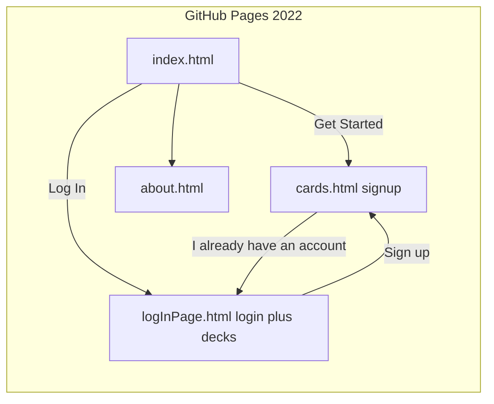
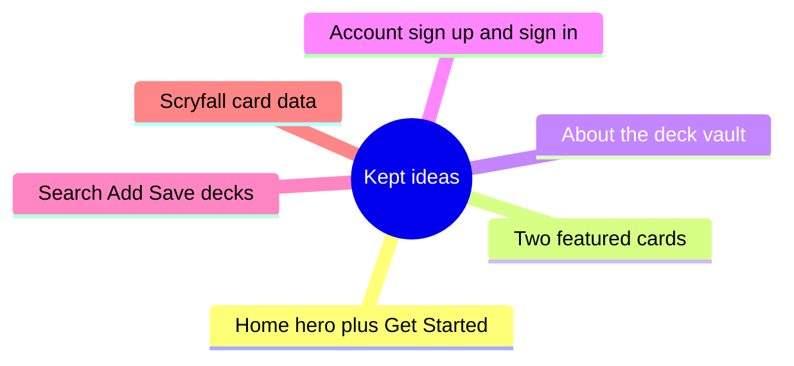
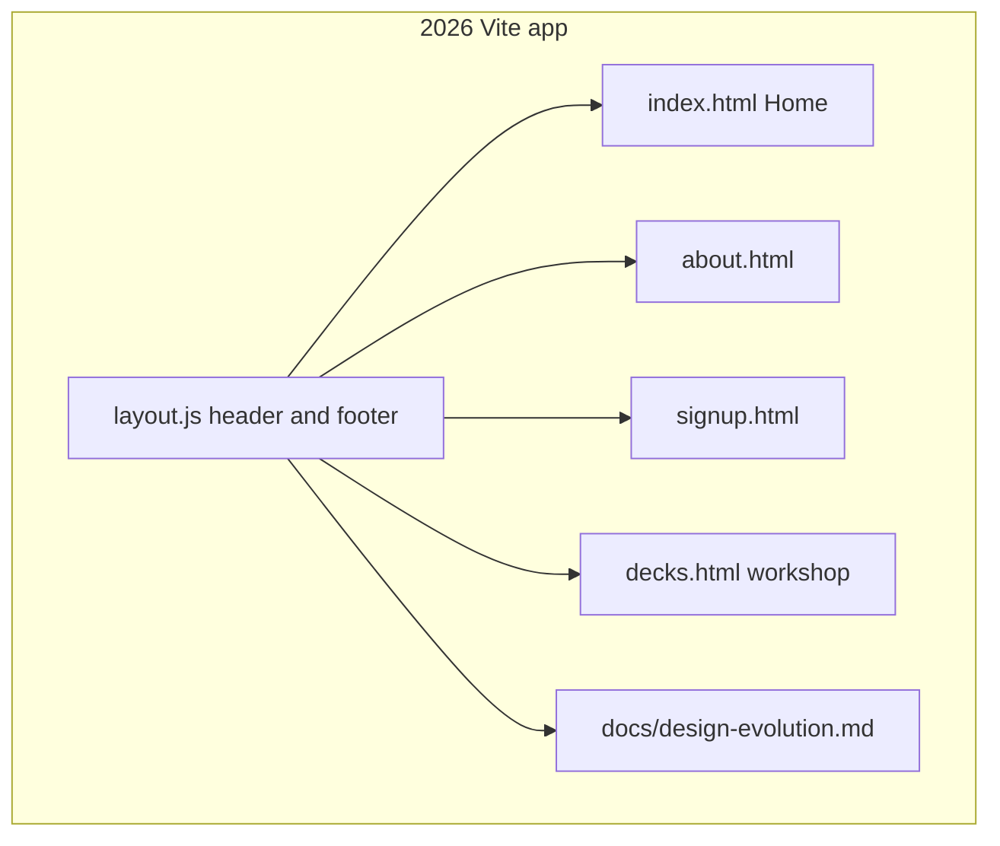
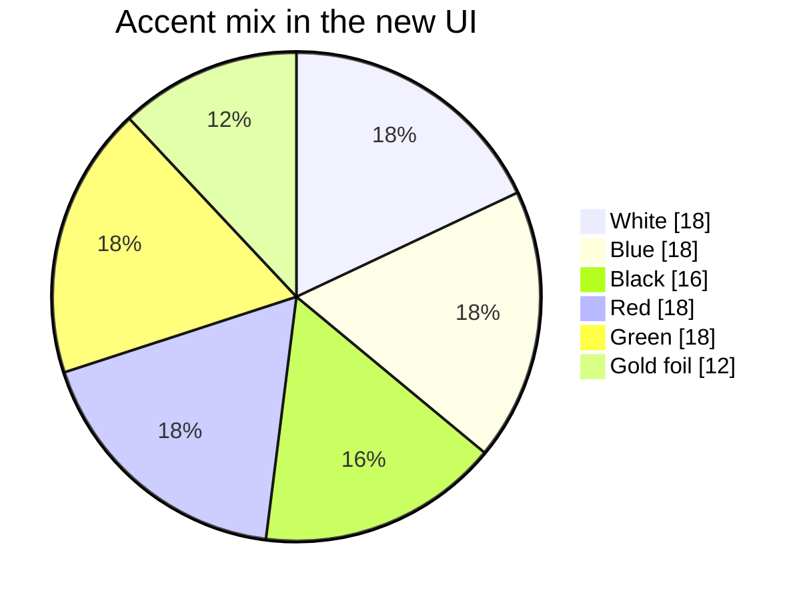
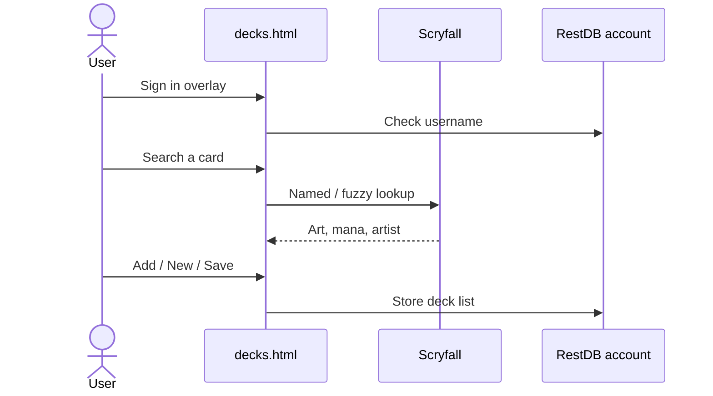

# Design evolution — Doneal's Deck Builder

A living note of **what this site was**, **what stayed**, and **what changed** in the 2026 rebuild.

Live preview: [http://127.0.0.1:3000/](http://127.0.0.1:3000/)  
This file: [http://127.0.0.1:3000/docs/design-evolution.md](http://127.0.0.1:3000/docs/design-evolution.md)

---

## What was here (2022 GitHub Pages)

A senior-project Magic: The Gathering deck builder. Visual language came mostly from **Bootstrap 5 Cover** plus a dark gray gradient. Pages were flat HTML files at the repo root (`index.html`, `about.html`, `cards.html`, `logInPage.html`).

| Surface | Original idea | Original look |
| --- | --- | --- |
| Home | Big title, Get Started, two random Scryfall cards | White Bootstrap button, gray cover page |
| About | One sentence explaining the app | Centered Cover heading |
| Sign up | Username / password / confirm | Bootstrap `form-signin` |
| Decks | Login overlay, then search, add, save, store lists | Bootstrap grid + outline buttons |

---

## What stayed

The product is still **Doneal's Deck Builder**: create, edit, and view MTG decks; pull art and names from **Scryfall**; keep lists behind an account.

---

## What changed

| Layer | Before | After |
| --- | --- | --- |
| Structure | Root HTML for GitHub Pages | Vite app under `src/` with shared layout |
| Visual system | Bootstrap Cover, gray gradient | Custom playmat UI, no Bootstrap CSS |
| Color | Near-monochrome dark | Five-color mana + gold foil accents |
| Type | Bootstrap / system | Fraunces display + Outfit UI |
| Pages | Misleading filenames (`cards.html` = signup) | `signup.html`, `decks.html` |
| Layout chrome | Copied nav on every page | One header/footer in `layout.js` |
| Notes | None | This hosted markdown file |

---

## Color language

The site now uses Magic's five colors as UI energy, not as a rules engine. Gold is the “foil” accent for primary actions.

- **White / gold** — identity, headings, Get Started / Sign in
- **Blue** — search, save, links
- **Black / violet** — playmat background
- **Red** — delete
- **Green** — new deck

---

## Deck workshop flow (unchanged behavior, new chrome)

IDs the old scripts still expect (`login-form`, `deckname`, `addCard`, `deckRoll`, and so on) were kept so the original deck-builder logic still runs.

---

## How to view this note

Open `/docs/design-evolution.md` on the local Vite server, or read it in the repo under `public/docs/`. GitHub will render the Mermaid diagrams on the file when this branch is pushed.
